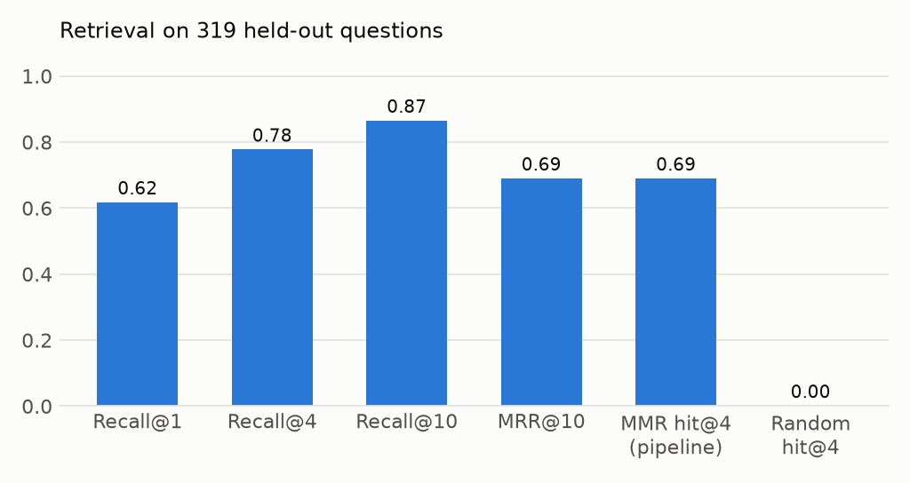
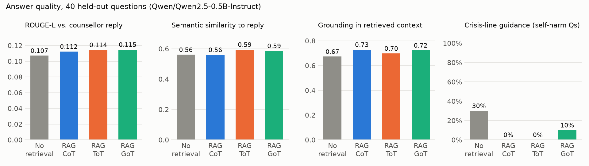

# Mental Health RAG Chatbot

A retrieval-augmented generation (RAG) chatbot that answers mental-health questions using a dataset of real
counselling conversations, and compares three reasoning-prompting strategies:

- **Chain of Thought (CoT):** reasons step by step.
- **Tree of Thoughts (ToT):** explores alternative explanations, then picks the strongest.
- **Graph of Thoughts (GoT):** connects ideas across the retrieved passages into one answer.

> ⚠️ **Disclaimer:** This is an educational project, not a medical device or a substitute for professional care.
> If you or someone you know is in crisis, contact local emergency services or a crisis line
> (in the US, call or text **988**).

## How it works

```
 question ──► embed (MiniLM) ──► FAISS (MMR, top-k) ──► retrieved conversations
                                                              │
                         CoT / ToT / GoT prompt  ◄────────────┘
                                   │
                                   ▼
                        Zephyr-7B (local, HF Transformers) ──► answer + sources
```

| Component | Choice |
|---|---|
| Dataset | [`CalebE/new_mental_health_conversations_all1`](https://huggingface.co/datasets/CalebE/new_mental_health_conversations_all1) (instruction / input / output) |
| Embeddings | `sentence-transformers/all-MiniLM-L6-v2` |
| Vector store | FAISS, max-marginal-relevance retrieval |
| LLM | `HuggingFaceH4/zephyr-7b-beta` through its chat template |
| Orchestration | LangChain (LCEL) |

The project grew out of two phases, both kept in [`notebooks/exploration.ipynb`](notebooks/exploration.ipynb):

1. **Phase 1, NLP analysis:** text cleaning, tokenization, spaCy POS tagging and BERT sentence embeddings
   (now in `src/mental_health_rag/preprocessing.py`).
2. **Phase 2, RAG chatbot:** vector retrieval and LLM generation with CoT/ToT/GoT prompts
   (now a reusable package and CLI).

## Project structure

```
.
├── notebooks/
│   └── exploration.ipynb        # original Phase 1 + Phase 2 experiments
├── eval/
│   ├── run_eval.py              # retrieval + generation evaluation, draws the figures
│   └── results/                 # metrics JSON and every generated answer
├── docs/figures/                # evaluation charts used in this README
├── src/mental_health_rag/
│   ├── config.py                # model names, chunking and generation settings (env-overridable)
│   ├── data.py                  # dataset loading → LangChain documents → chunks
│   ├── preprocessing.py         # Phase 1: cleaning, tokenization, POS tags, BERT embeddings
│   ├── vectorstore.py           # build / save / load the FAISS index
│   ├── prompts.py               # CoT, ToT, GoT prompt templates
│   ├── llm.py                   # loads Zephyr-7B once (fp16 or 4-bit)
│   ├── chain.py                 # retrieval + generation pipeline
│   └── __main__.py              # CLI
├── pyproject.toml
└── requirements.txt
```

## Getting started

**Requirements:** Python 3.10+. A GPU with about 16 GB of VRAM is recommended for Zephyr-7B in fp16, or about 6 GB with `--4bit`.
It runs on CPU, but slowly.

```bash
git clone <this-repo-url> && cd genai_chatbot
python -m venv .venv && source .venv/bin/activate
pip install -e .            # add [nlp] for Phase 1 analysis, [quant] for 4-bit loading
```

**1. Build the vector index** (downloads the dataset and saves the index to `artifacts/faiss_index/`):

```bash
python -m mental_health_rag build-index            # full dataset
python -m mental_health_rag build-index --limit 500 # quick test
```

**2. Ask a question:**

```bash
python -m mental_health_rag ask "How can I manage anxiety?"
python -m mental_health_rag ask "How does stress impact mental health?" --strategy all --sources
```

**3. Or chat interactively:**

```bash
python -m mental_health_rag chat --strategy tot
```

### Use it from Python

```python
from mental_health_rag.chain import MentalHealthRAG
from mental_health_rag.llm import load_llm
from mental_health_rag.vectorstore import load_index

rag = MentalHealthRAG(load_index(), load_llm())
answer = rag.ask("How can I sleep better when I'm stressed?", strategy="got")
print(answer.text)
```

### Configuration

Any setting in `config.py` can be overridden with an environment variable, for example:

```bash
LLM_MODEL=mistralai/Mistral-7B-Instruct-v0.3 TOP_K=6 python -m mental_health_rag ask "..."
```

| Variable | Default |
|---|---|
| `LLM_MODEL` | `HuggingFaceH4/zephyr-7b-beta` |
| `EMBEDDING_MODEL` | `sentence-transformers/all-MiniLM-L6-v2` |
| `INDEX_DIR` | `artifacts/faiss_index` |
| `TOP_K` | `4` |
| `CHUNK_SIZE` / `CHUNK_OVERLAP` | `500` / `50` |
| `MAX_NEW_TOKENS`, `TEMPERATURE`, `TOP_P` | `512`, `0.7`, `0.95` |

## Evaluation

All numbers below come from [`eval/run_eval.py`](eval/run_eval.py) on the full dataset (13,358 conversations).
Raw results are in [`eval/results/`](eval/results/).

**Setup.** Many patient questions in the dataset appear several times with different counsellor replies.
For a seeded sample of 319 such questions (300 general + all 19 repeated self-harm/suicide questions), one
conversation is held out and everything else is indexed with the package's own pipeline
(25,442 chunks). The held-out counsellor reply is never in the index, so it serves as a clean
reference answer.

### Retrieval



A hit means a retrieved chunk comes from another conversation about the same question.

| Metric | Score |
|---|---|
| Recall@1 / @4 / @10 | **0.62 / 0.78 / 0.87** |
| MRR@10 | 0.69 |
| Pipeline retriever (MMR, k=4) hit rate | 0.69, with 3.7 distinct conversations per query |
| Random-chunk baseline hit@4 | 0.001 |
| Query latency (CPU) | ~11 ms |

MMR trades some recall for diversity: about 9 points lower hit rate than plain similarity search at k=4,
but the 4 passages almost always come from different conversations.

### Answer quality: CoT vs ToT vs GoT



The same 40 held-out questions (30 general, 10 self-harm), answered with no retrieval and with RAG plus each prompting strategy.
Grounding is the embedding similarity between an answer and the retrieved passages. Semantic similarity uses MiniLM.

| Condition | ROUGE-L | Similarity to counsellor reply | Grounding in context | Crisis-line mention |
|---|---|---|---|---|
| No retrieval | 0.107 | 0.56 | 0.67 | 3 / 10 |
| RAG + CoT | 0.112 | 0.56 | **0.73** | 0 / 10 |
| RAG + ToT | 0.114 | **0.59** | 0.70 | 0 / 10 |
| RAG + GoT | **0.115** | 0.59 | 0.72 | 1 / 10 |

**Takeaways**

- **Retrieval grounds the answers.** All three RAG variants stick closer to the source conversations than the no-retrieval baseline (+0.03 to +0.06).
  CoT is the most grounded. ToT and GoT come closest to what a human counsellor actually said.
- **ROUGE gains are small** (0.107 → 0.115). Free-form counselling replies vary a lot, so lexical overlap is a weak signal at n=40.
- **Safety regression:** with retrieved context in the prompt, the model mostly stops giving crisis-line guidance on self-harm
  questions. The long context crowds out the system prompt's instruction.
  A deterministic check that appends crisis resources when self-harm is detected would be a more reliable fix than prompting.

> **Caveat:** these generation numbers were produced with **Qwen2.5-0.5B-Instruct** on an 8 GB Apple M2,
> because Zephyr-7B does not fit in that memory. The pipeline, prompts and retriever are identical.
> To reproduce with the default model on a GPU:

```bash
pip install -e ".[eval]"
python eval/run_eval.py retrieval
python eval/run_eval.py generation --n 30                 # uses LLM_MODEL (Zephyr-7B by default)
LLM_MODEL=Qwen/Qwen2.5-0.5B-Instruct MAX_NEW_TOKENS=320 python eval/run_eval.py generation   # as reported
```

On macOS, set `KMP_DUPLICATE_LIB_OK=TRUE OMP_NUM_THREADS=1` first. Otherwise FAISS and PyTorch load
conflicting OpenMP runtimes and the process segfaults.

**Dataset note:** in this dataset the patient question is stored in `instruction`, while `input` holds the same
boilerplate on every row ("If you are a licensed psychologist, please provide…"). About half of all indexed chunks contain
that boilerplate, which dilutes the embeddings. Dropping it is the most obvious next improvement to retrieval.
